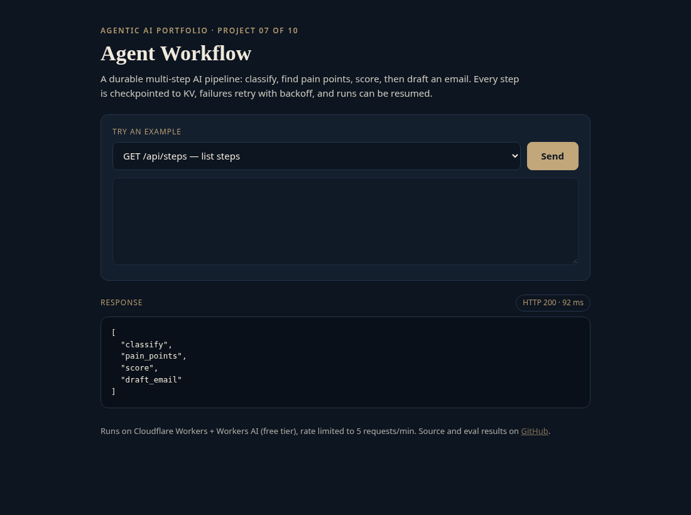
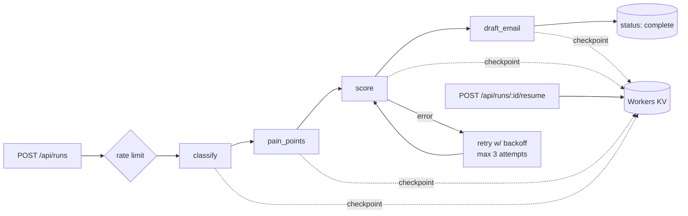

# agent-07-workflow

**Agent Workflow: durable, checkpointed AI pipeline**

**Live demo:** https://agent-07-workflow.braylo777.workers.dev



## What it is
A multi-step AI workflow engine (project 7 of a 10-part agentic AI portfolio). A sales lead goes through four LLM steps (classify, find pain points, score, draft an email). Every step is checkpointed to KV, failed steps retry with exponential backoff, and a run can be resumed from its last completed step.

## Architecture


## How it works
- `src/workflow.js`: step definitions, retry loop (`MAX_ATTEMPTS = 3`, backoff 250ms × 2ⁿ), KV checkpoint after every step, resume skips completed steps.
- `src/index.js`: REST API (`/api/runs`, `/api/runs/:id`, `/api/runs/:id/resume`, `/api/steps`), input validation, per-IP rate limit.
- `fail_step` lets you inject a first-attempt failure into any step to watch recovery live.
- Runs serverless on Cloudflare Workers with the free Workers AI tier (`@cf/meta/llama-3.3-70b-instruct-fp8-fast`); 5 requests/min per IP keeps the demo free.

## Eval results
Measured against the **live** deployment with real model calls (`node evals/run.mjs`), run 2026-10-28. Raw per-case output: [`evals/results.json`](evals/results.json). Small sample sizes, kept small to stay inside the free daily model quota, so read these as indicative, not definitive.

| Metric | Result |
|---|---|
| Step completion (schema-valid step outputs) | 64/64 (100%) |
| Run completion | 16/16 (100%) |
| Recovery rate (injected failures that retried and completed) | 8/8 (100%) |
| Natural (non-injected) step failures | 0 failed, 0 recovered |
| Latency p50 / p95 (end-to-end HTTP) | 5237 ms / 8768 ms (n=16) |

## Tests
10/10 unit tests pass (`npm test`, Node 20+, the LLM is mocked so they run offline).

## Run it
```bash
npm install
npm test               # offline unit tests
node evals/run.mjs     # live evals (BASE=http://localhost:8787 for local)
npx wrangler dev       # local; Workers AI via your Cloudflare login
npx wrangler deploy    # free tier, no paid API keys
```

## License
MIT
